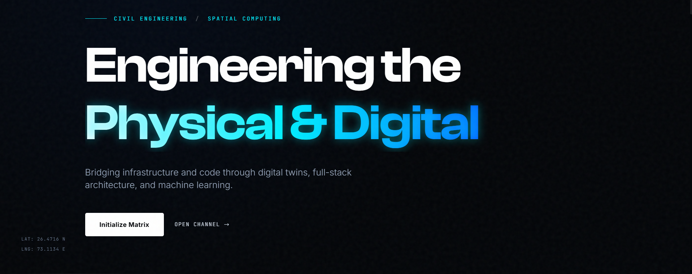
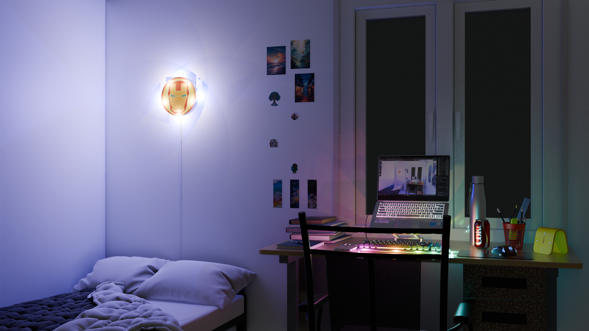

  <!-- Main Portfolio Banner from ./assets/ -->
  
    

  <!-- Dynamic Typing Header matching SYS.ARCHITECT aesthetic -->
  

  

    <b>Civil Engineering Undergraduate @ IIT Jodhpur</b> 
    <i>Bridging infrastructure and code through digital twins, 3D spatial web architectures, headless rendering pipelines, and embedded AI.</i>
  

  <!-- Live Deployment & Uplink Badges -->
  

    
    
  

<h3><code>// 01. SYSTEM_TELEMETRY & ARCHITECTURE</code></h3>

<pre lang="yaml"><code>operator: "Shrey Vishwakarma (ShreyV-bot)"
institution: "Indian Institute of Technology (IIT) Jodhpur"
discipline: "B.Tech in Civil & Infrastructure Engineering"
coordinates: "LAT: 26.4710 N | LNG: 73.1134 E"
core_domains:
  - Spatial Computing & Interactive 3D Web (Three.js, React Three Fiber, WebGL)
  - Automated 3D Pipelines (Blender Python API / bpy, Headless CLI Rendering, PBR Baking)
  - Full-Stack Systems (Next.js, TypeScript, Node.js, Fastify/Express, Prisma, PostgreSQL, Redis)
  - Edge AI, Robotics & Embedded Hardware (ESP32 CSI, C++, Computer Vision, MuJoCo)</code></pre>

<h3><code>// 02. FEATURED_DEPLOYMENTS (MATRIX)</code></h3>

<table width="100%">
  <tr>
    <td width="50%" valign="top">
      <h3 align="center">🌐 IITJ 3D Hostel Room (Digital Twin)</h3>
      

        
      

      

        <a href="[https://iitj-3d-room.vercel.app](https://iitj-3d-room.vercel.app)"><b>Live Interactive Demo</b></a> • 
        <a href="[https://github.com/ShreyV-bot/iitj-3d-room](https://github.com/ShreyV-bot/iitj-3d-room)"><b>Repository</b></a>
      

      
An interactive, 360-degree spatial web environment of my IIT Jodhpur hostel room built from exact architectural dimensions. Features custom procedural PBR textures, interactive rocker switches, zoomable device screens, and optimized GLB asset delivery using <b>Next.js, TypeScript, Three.js, and React Three Fiber</b>.

    </td>
    <td width="50%" valign="top">
      <h3 align="center">⚡ Blender Headless Render Pipelines</h3>
      

        <a href="[https://github.com/ShreyV-bot/blender-headless-render-pipelines](https://github.com/ShreyV-bot/blender-headless-render-pipelines)"><b>Render Pipelines Repo</b></a> • 
        <a href="[https://github.com/ShreyV-bot/Blender-Universal-PBR-Baker](https://github.com/ShreyV-bot/Blender-Universal-PBR-Baker)"><b>Universal PBR Baker</b></a> • 
        <a href="[https://github.com/ShreyV-bot/Blender_glb_exporter](https://github.com/ShreyV-bot/Blender_glb_exporter)"><b>GLB Exporter</b></a>
      

      
Automated background CLI rendering suite for <b>Blender 4.4+</b> supporting GPU-only EEVEE, CPU-capped Cycles, and hybrid multi-worker execution under strict memory constraints. Paired with a one-click Python (<code>bpy</code>) pipeline to losslessly bake complex procedural node trees into game-ready PBR textures.

      

      <h3 align="center">📡 ESP32-WiFi-PoseSense & RC Hardware</h3>
      

        <a href="[https://github.com/ShreyV-bot/ESP32-WiFi-PoseSense](https://github.com/ShreyV-bot/ESP32-WiFi-PoseSense)"><b>PoseSense Repo</b></a> • 
        <a href="[https://github.com/ShreyV-bot/ESP32-UNO-WiFi-Car](https://github.com/ShreyV-bot/ESP32-UNO-WiFi-Car)"><b>WiFi Car Repo</b></a>
      

      
Through-wall human activity recognition leveraging <b>ESP32 Channel State Information (CSI)</b> and deep learning classifiers, alongside low-latency WiFi-controlled autonomous rover firmware engineered with <b>C++, Arduino Uno, and HW130 motor shields</b>.

      

      <h3 align="center">📸 Smart Slide Capture</h3>
      

        <a href="[https://github.com/ShreyV-bot/smart-slide-capture](https://github.com/ShreyV-bot/smart-slide-capture)"><b>Repository</b></a>
      

      
AI-powered classroom companion mobile application engineered in <b>TypeScript and React Native</b> designed for students to automatically detect, de-skew, and capture clean lecture slides in real time without visual clutter.

    </td>
  </tr>
</table>

<h3><code>// 03. TECH_ARSENAL</code></h3>

  <b>Spatial Computing, 3D & Simulation</b> 
  
    

  <b>Full-Stack Web & Mobile Architecture</b> 
  
    

  <b>Embedded Systems, AI & Engineering Tools</b> 
  

<h3><code>// 04. OPERATOR_METRICS</code></h3>

  
  

  

